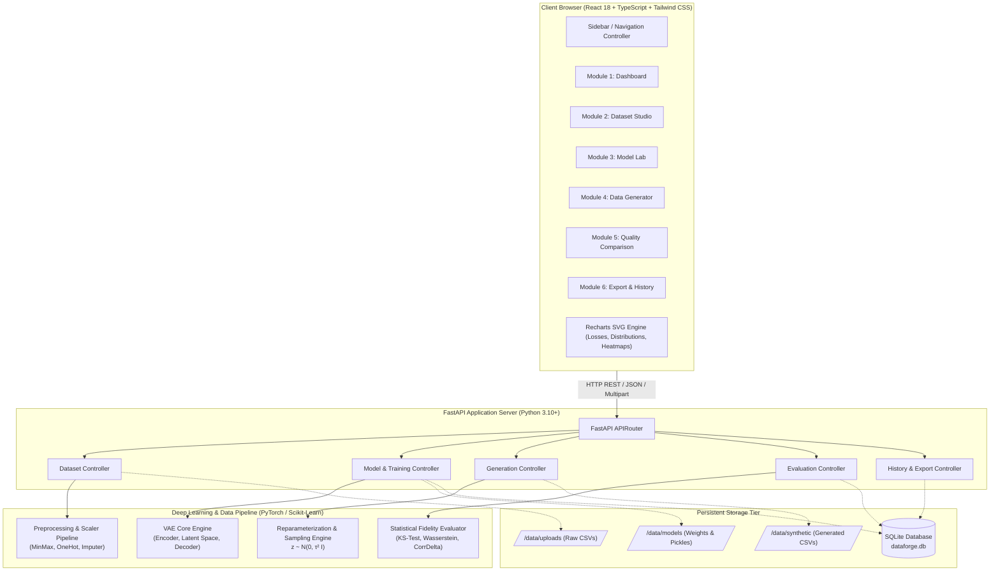
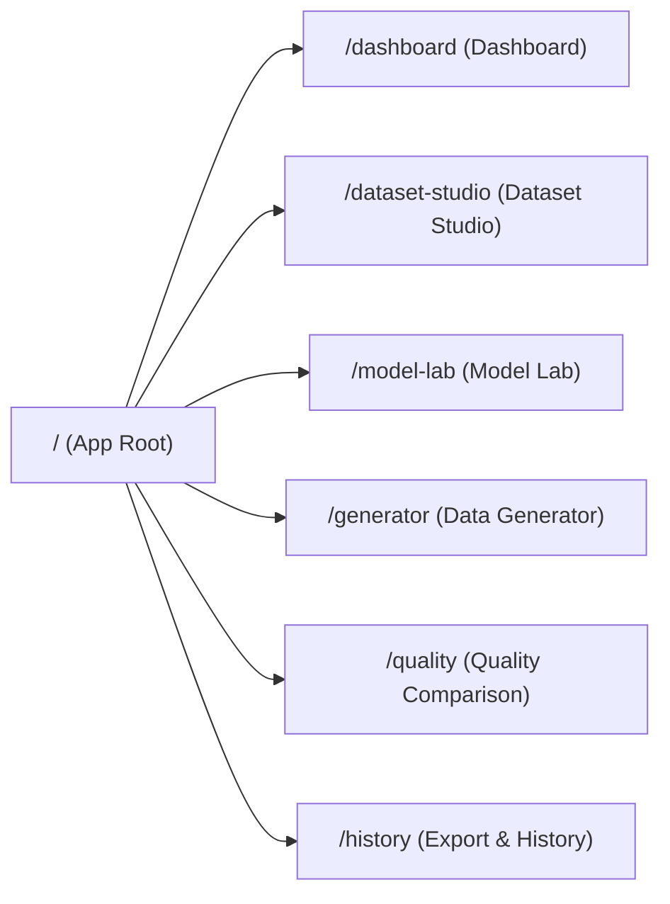
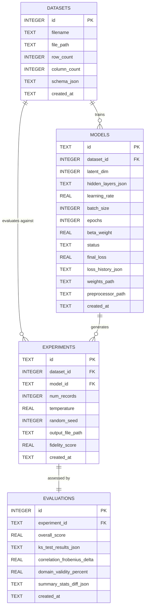
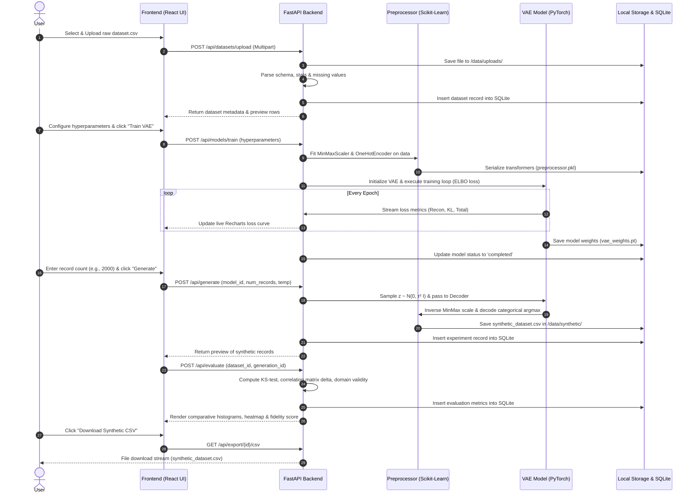

# DataForge: Deep Learning-Based Synthetic Data Generation
## Phase 2: System Design & Architecture Document
**Course / Subject:** AI23531 – Deep Learning  
**Project Title:** DataForge – Deep Learning-Based Synthetic Data Generation Platform  
**Document Version:** 1.0.0  
**Status:** Approved for Implementation  

---

## 1. System Architecture Overview

DataForge follows a decoupled, modular 3-tier architecture:
1. **Presentation Tier (Frontend):** Modern Single Page Application (SPA) built with React 18, TypeScript, Tailwind CSS, and Recharts for interactive visualizations and dynamic parameter control.
2. **Application Tier (Backend API):** High-performance asynchronous REST API powered by FastAPI (Python 3.10+), orchestrating dataset profiling, transformation pipelines, model training jobs, and statistical evaluations.
3. **Deep Learning & Processing Engine:** PyTorch / TensorFlow VAE implementation utilizing custom training loops, continuous latent vector sampling, and Scikit-learn/Pandas preprocessing and evaluation routines.
4. **Data & Storage Tier:** Lightweight SQLite database storing experiment runs, model metadata, and evaluation metrics, combined with local disk storage for uploaded datasets, trained model weights, and synthetic CSV outputs.

### 1.1 Complete System Architecture Diagram



---

## 2. Website Pages & Navigation Design

### 2.1 Navigation Structure & Routing
The frontend implements client-side routing via React Router (v6). A persistent sidebar navigation bar allows effortless switching between the 6 modules, with the active dataset and active model displayed globally in the header status indicator.



| Route | Page Name | Primary User Actions & Responsibilities |
| :--- | :--- | :--- |
| `/` or `/dashboard` | **Dashboard** | High-level metrics KPI cards, system status, active dataset badge, recent generation runs table, quick start guides. |
| `/dataset-studio` | **Dataset Studio** | Drag-and-drop CSV upload, preview first 100 rows, view descriptive stats, configure feature types (Numeric vs. Categorical), select missing value strategy. |
| `/model-lab` | **Model Lab** | Configure VAE hyperparameters (latent dimensions, hidden units, learning rate, epochs, batch size, $\beta$-weight), trigger training, view live loss curves (Reconstruction, KL, Total ELBO). |
| `/generator` | **Data Generator** | Select trained model, set record count slider, adjust sampling temperature ($\tau$), trigger synthetic generation, instant preview of synthesized data. |
| `/quality` | **Quality Comparison** | Side-by-side descriptive stats, overlaid probability distribution histograms, Pearson correlation difference heatmaps, domain validity checks, composite fidelity score. |
| `/history` | **Export & History** | Comprehensive audit table of all historical runs, download generated CSV files, download JSON/PDF quality reports, reload previous model weights. |

### 2.2 Global Layout & Shell Structure
```
┌──────────────────────────────────────────────────────────────────────────────┐
│  [Logo] DataForge  │ Active Dataset: student_data.csv │ Active Model: VAE-Z8 │
├───────────────┬──────────────────────────────────────────────────────────────┤
│               │                                                              │
│  📊 Dashboard  │                     MAIN WORKSPACE AREA                      │
│  📁 Studio    │                                                              │
│  🧠 Model Lab │   (Dynamic component rendered according to active route)     │
│  ⚡ Generator  │                                                              │
│  📈 Quality   │                                                              │
│  💾 History   │                                                              │
│               │                                                              │
├───────────────┴──────────────────────────────────────────────────────────────┤
│  System Status: Online | Backend: Connected (v1.0.0) | Device: CPU / CUDA     │
└──────────────────────────────────────────────────────────────────────────────┘
```

---

## 3. REST API Endpoints Specification

All backend endpoints are served under the `/api` prefix, utilizing standard HTTP status codes, structured JSON error responses, and OpenAPI/Swagger documentation at `/docs`.

### 3.1 Datasets Management API
| Method | Endpoint | Description | Request Payload | Response Schema |
| :--- | :--- | :--- | :--- | :--- |
| `POST` | `/api/datasets/upload` | Upload new tabular CSV file | `multipart/form-data` (file: `Binary`) | `{ "id": 1, "filename": "data.csv", "rows": 1000, "columns": 8, "schema": [...] }` |
| `GET` | `/api/datasets` | List all uploaded datasets | *None* | `[ { "id": 1, "filename": "...", "rows": 1000, "created_at": "..." } ]` |
| `GET` | `/api/datasets/{id}` | Get dataset summary & preview | *Query:* `limit=50&offset=0` | `{ "id": 1, "preview": [...], "statistics": {...}, "missing_values": {...} }` |
| `POST` | `/api/datasets/{id}/preprocess` | Configure and run preprocessing | `{ "drop_columns": ["id"], "categorical_cols": ["gender"], "impute_strategy": "median" }` | `{ "dataset_id": 1, "processed_dim": 12, "feature_names": [...], "ready_for_training": true }` |

### 3.2 Model Training & Management API
| Method | Endpoint | Description | Request Payload | Response Schema |
| :--- | :--- | :--- | :--- | :--- |
| `POST` | `/api/models/train` | Launch VAE model training | `{ "dataset_id": 1, "latent_dim": 8, "hidden_layers": [128, 64], "lr": 0.001, "epochs": 50, "batch_size": 32, "beta": 1.0 }` | `{ "model_id": "vae_20261012_01", "status": "training", "total_epochs": 50 }` |
| `GET` | `/api/models/{id}/status` | Poll live training progress & loss | *None* | `{ "model_id": "...", "status": "completed", "current_epoch": 50, "loss_history": { "total": [...], "recon": [...], "kl": [...] } }` |
| `POST` | `/api/models/{id}/stop` | Interrupt training run | *None* | `{ "model_id": "...", "status": "stopped" }` |
| `GET` | `/api/models` | List all trained models | *None* | `[ { "id": "...", "dataset_id": 1, "latent_dim": 8, "final_loss": 0.042 } ]` |

### 3.3 Synthetic Data Generation API
| Method | Endpoint | Description | Request Payload | Response Schema |
| :--- | :--- | :--- | :--- | :--- |
| `POST` | `/api/generate` | Generate synthetic records | `{ "model_id": "...", "num_records": 1000, "temperature": 1.0, "random_seed": 42 }` | `{ "generation_id": "gen_982", "model_id": "...", "num_records": 1000, "created_at": "..." }` |
| `GET` | `/api/generate/{id}/preview` | Preview synthetic records | *Query:* `limit=50&offset=0` | `{ "generation_id": "...", "records": [...], "count": 1000 }` |

### 3.4 Quality Assessment & Evaluation API
| Method | Endpoint | Description | Request Payload | Response Schema |
| :--- | :--- | :--- | :--- | :--- |
| `POST` | `/api/evaluate` | Compare real vs synthetic data | `{ "dataset_id": 1, "generation_id": "gen_982" }` | `{ "overall_fidelity_score": 91.4, "ks_statistics": {...}, "correlation_matrix_diff": [...], "domain_validity": 99.8 }` |

### 3.5 Export & Experiment History API
| Method | Endpoint | Description | Request Payload | Response Schema |
| :--- | :--- | :--- | :--- | :--- |
| `GET` | `/api/history` | List complete experiment runs | *None* | `[ { "id": 1, "dataset_name": "...", "records": 1000, "fidelity_score": 91.4, "timestamp": "..." } ]` |
| `GET` | `/api/export/{generation_id}/csv` | Download generated CSV file | *None* | `text/csv` attachment stream |
| `GET` | `/api/export/{generation_id}/report`| Download full evaluation JSON | *None* | `application/json` report payload |

---

## 4. Database Schema Design (SQLite)

The persistence layer uses SQLite with four normalized tables capturing the lifecycle of datasets, models, generation experiments, and evaluation results.



### 4.1 SQL DDL Schema Definition
```sql
-- 1. Datasets Table
CREATE TABLE IF NOT EXISTS datasets (
    id INTEGER PRIMARY KEY AUTOINCREMENT,
    filename TEXT NOT NULL,
    file_path TEXT NOT NULL,
    row_count INTEGER NOT NULL,
    column_count INTEGER NOT NULL,
    schema_json TEXT NOT NULL, -- JSON list of column names, data types, missing counts
    created_at TIMESTAMP DEFAULT CURRENT_TIMESTAMP
);

-- 2. Models Table
CREATE TABLE IF NOT EXISTS models (
    id TEXT PRIMARY KEY, -- e.g., 'vae_20261012_143022'
    dataset_id INTEGER NOT NULL,
    latent_dim INTEGER NOT NULL DEFAULT 8,
    hidden_layers_json TEXT NOT NULL, -- e.g., '[128, 64]'
    learning_rate REAL NOT NULL DEFAULT 0.001,
    batch_size INTEGER NOT NULL DEFAULT 32,
    epochs INTEGER NOT NULL DEFAULT 50,
    beta_weight REAL NOT NULL DEFAULT 1.0,
    status TEXT NOT NULL DEFAULT 'initialized', -- 'initialized', 'training', 'completed', 'failed'
    final_loss REAL,
    loss_history_json TEXT, -- JSON containing total_loss, recon_loss, kl_loss arrays
    weights_path TEXT,
    preprocessor_path TEXT,
    created_at TIMESTAMP DEFAULT CURRENT_TIMESTAMP,
    FOREIGN KEY (dataset_id) REFERENCES datasets(id) ON DELETE CASCADE
);

-- 3. Experiments / Generations Table
CREATE TABLE IF NOT EXISTS experiments (
    id TEXT PRIMARY KEY, -- e.g., 'gen_20261012_150211'
    dataset_id INTEGER NOT NULL,
    model_id TEXT NOT NULL,
    num_records INTEGER NOT NULL,
    temperature REAL NOT NULL DEFAULT 1.0,
    random_seed INTEGER DEFAULT 42,
    output_file_path TEXT NOT NULL,
    fidelity_score REAL,
    created_at TIMESTAMP DEFAULT CURRENT_TIMESTAMP,
    FOREIGN KEY (dataset_id) REFERENCES datasets(id) ON DELETE CASCADE,
    FOREIGN KEY (model_id) REFERENCES models(id) ON DELETE CASCADE
);

-- 4. Evaluations Table
CREATE TABLE IF NOT EXISTS evaluations (
    id INTEGER PRIMARY KEY AUTOINCREMENT,
    experiment_id TEXT NOT NULL UNIQUE,
    overall_score REAL NOT NULL, -- 0.0 to 100.0 scale
    ks_test_results_json TEXT NOT NULL, -- JSON column-wise KS stats & p-values
    correlation_frobenius_delta REAL NOT NULL,
    domain_validity_percent REAL NOT NULL,
    summary_stats_diff_json TEXT NOT NULL,
    created_at TIMESTAMP DEFAULT CURRENT_TIMESTAMP,
    FOREIGN KEY (experiment_id) REFERENCES experiments(id) ON DELETE CASCADE
);

-- Indices for rapid querying
CREATE INDEX IF NOT EXISTS idx_models_dataset ON models(dataset_id);
CREATE INDEX IF NOT EXISTS idx_experiments_model ON experiments(model_id);
CREATE INDEX IF NOT EXISTS idx_evaluations_experiment ON evaluations(experiment_id);
```

---

## 5. End-to-End Data Flow (CSV Upload to CSV Export)

The complete lifecycle follows a 6-stage pipelined flow from raw user input to production-ready synthetic data export:



---

## 6. UI Wireframes for the Six Core Modules

Below are structured high-fidelity wireframe layouts detailing every view of the user interface.

### 6.1 Module 1: Dashboard (`/dashboard`)
```
┌──────────────────────────────────────────────────────────────────────────────┐
│ DataForge Dashboard                                       [ + Upload CSV ]   │
├──────────────────────────────────────────────────────────────────────────────┤
│  ┌────────────────┐  ┌────────────────┐  ┌────────────────┐  ┌─────────────┐ │
│  │ Total Datasets │  │ Models Trained │  │ Generated Rows │  │ Avg Fidelity│ │
│  │       3        │  │       5        │  │     12,500     │  │    92.4%    │ │
│  └────────────────┘  └────────────────┘  └────────────────┘  └─────────────┘ │
├──────────────────────────────────────────────────────────────────────────────┤
│  ACTIVE SYSTEM STATE                                                         │
│  Dataset: student_scores.csv (1,000 rows, 6 cols)  │ Model: VAE-Z8 (Converged)│
├──────────────────────────────────────────────────────────────────────────────┤
│  RECENT EXPERIMENTS & GENERATION RUNS                                        │
│  ┌────────────┬──────────────────┬──────────┬───────────┬──────────┬───────┐ │
│  │ ID         │ Dataset          │ Records  │ Latent Dim│ Fidelity │Action │ │
│  ├────────────┼──────────────────┼──────────┼───────────┼──────────┼───────┤ │
│  │ gen_1092   │ student_scores   │ 2,000    │ z = 8     │ 94.2%    │[View] │ │
│  │ gen_1091   │ retail_sales     │ 5,000    │ z = 16    │ 89.8%    │[View] │ │
│  │ gen_1088   │ student_scores   │ 500      │ z = 4     │ 91.0%    │[View] │ │
│  └────────────┴──────────────────┴──────────┴───────────┴──────────┴───────┘ │
└──────────────────────────────────────────────────────────────────────────────┘
```

### 6.2 Module 2: Dataset Studio (`/dataset-studio`)
```
┌──────────────────────────────────────────────────────────────────────────────┐
│ Dataset Studio: Upload & Feature Profiling                                   │
├──────────────────────────────────────────────────────────────────────────────┤
│  ┌────────────────────────────────────────────────────────────────────────┐  │
│  │  📂 Drag and Drop your CSV dataset here, or [Browse Files]             │  │
│  │  Supported formats: .csv (Max 25 MB)                                   │  │
│  └────────────────────────────────────────────────────────────────────────┘  │
├──────────────────────────────────────────────────────────────────────────────┤
│  DATASET PREVIEW & FEATURE CONFIGURATION (student_scores.csv - 1,000 rows)   │
│  ┌───┬──────────────┬─────────────┬───────────┬──────────┬─────────────────┐ │
│  │Use│ Column Name  │ Inferred    │ Override  │ Nulls    │ Imputation Rule │ │
│  ├───┼──────────────┼─────────────┼───────────┼──────────┼─────────────────┤ │
│  │[x]│ math_score   │ Numeric     │ [Numeric▼]│ 0 (0%)   │ [Median       ▼]│ │
│  │[x]│ study_hours  │ Numeric     │ [Numeric▼]│ 4 (0.4%) │ [Median       ▼]│ │
│  │[x]│ attendance   │ Numeric     │ [Numeric▼]│ 0 (0%)   │ [Mean         ▼]│ │
│  │[x]│ grade_tier   │ Categorical │ [Categ. ▼]│ 0 (0%)   │ [Mode         ▼]│ │
│  │[ ]│ student_id   │ Identifier  │ [Drop   ▼]│ 0 (0%)   │ [Drop         ▼]│ │
│  └───┴──────────────┴─────────────┴───────────┴──────────┴─────────────────┘ │
│  [ Apply Transformations & Save Pipeline ]                                   │
└──────────────────────────────────────────────────────────────────────────────┘
```

### 6.3 Module 3: Model Lab (`/model-lab`)
```
┌──────────────────────────────────────────────────────────────────────────────┐
│ Model Lab: Variational Autoencoder (VAE) Training Suite                      │
├──────────────────────────────────────┬───────────────────────────────────────┤
│ HYPERPARAMETER SETTINGS              │ LIVE TRAINING PROGRESS & LOSS MONITOR │
│                                      │ Epoch: 45 / 50   [████████████░░] 90% │
│ Latent Bottleneck Dimension (z):     │                                       │
│ [ 8               ] (2 to 32)        │ Total Loss: 0.0412                    │
│                                      │ Recon Loss: 0.0381  |  KL Loss: 0.0031│
│ Hidden Layers:                       │                                       │
│ [ 128, 64         ]                  │  Loss                                 │
│                                      │  1.0│                                 │
│ Learning Rate:                       │     │ ╲   — Total Loss                │
│ [ 0.001           ]                  │  0.5│  ╲  --- Recon Loss              │
│                                      │     │   ╲ ... KL Divergence           │
│ Batch Size:  [ 32         ▼]         │  0.0└──────────────────────── Epoch   │
│ Epochs:      [ 50         ]          │      0    10   20   30   40   50      │
│ Beta Weight: [ 1.0        ]          │                                       │
│                                      │ Status: Training in progress...       │
│ [ ▶ Start Training ] [ ⏹ Stop ]      │                                       │
└──────────────────────────────────────┴───────────────────────────────────────┘
```

### 6.4 Module 4: Data Generator (`/generator`)
```
┌──────────────────────────────────────────────────────────────────────────────┐
│ Data Generator: Latent Space Sampling & Record Synthesis                     │
├──────────────────────────────────────────────────────────────────────────────┤
│ GENERATION CONTROLS                                                          │
│ Model: [ VAE-Z8 (student_scores - Epoch 50) ▼ ]                              │
│ Number of Records: [ 2,000      ] (Range: 100 - 20,000)                      │
│ Sampling Temperature (τ): [ 1.0 ] (0.2: high fidelity <─> 1.8: high diversity│
│ Random Seed: [ 42        ]                                                   │
│                                                                              │
│ [ ⚡ Generate Synthetic Dataset ]                                            │
├──────────────────────────────────────────────────────────────────────────────┤
│ SYNTHETIC OUTPUT PREVIEW (Showing first 5 of 2,000 generated records)        │
│ ┌──────┬────────────┬─────────────┬────────────┬────────────┬──────────────┐ │
│ │ Row  │ math_score │ study_hours │ attendance │ grade_tier │ Validity     │ │
│ ├──────┼────────────┼─────────────┼────────────┼────────────┼──────────────┤ │
│ │ #1   │ 78.4       │ 14.2        │ 91.5%      │ Tier B     │ Valid ✓      │ │
│ │ #2   │ 92.1       │ 22.0        │ 98.0%      │ Tier A     │ Valid ✓      │ │
│ │ #3   │ 64.0       │ 8.5         │ 82.3%      │ Tier C     │ Valid ✓      │ │
│ │ #4   │ 85.6       │ 18.1        │ 94.2%      │ Tier B     │ Valid ✓      │ │
│ │ #5   │ 58.2       │ 6.1         │ 76.0%      │ Tier D     │ Valid ✓      │ │
│ └──────┴────────────┴─────────────┴────────────┴────────────┴──────────────┘ │
└──────────────────────────────────────────────────────────────────────────────┘
```

### 6.5 Module 5: Quality Comparison & Diagnostics (`/quality`)
```
┌──────────────────────────────────────────────────────────────────────────────┐
│ Quality Comparison: Real vs. Synthetic Statistical Fidelity                  │
├──────────────────────────────────────────────────────────────────────────────┤
│ OVERALL FIDELITY SCORE: 93.6% [ HIGH FIDELITY ]   Domain Validity: 99.8%     │
├──────────────────────────────────────┬───────────────────────────────────────┤
│ FEATURE DISTRIBUTION COMPARISON      │ CORRELATION MATRIX DELTA (|Real - Syn|)│
│ Feature: [ math_score             ▼] │                                       │
│                                      │           math  study  atten          │
│ Density                              │    math  [0.00  0.03   0.02]          │
│   │   ╭─╮         ── Real Data       │    study [0.03  0.00   0.04]          │
│   │  ╭╯ ╰╮        -- Synthetic Data  │    atten [0.02  0.04   0.00]          │
│   │ ╭╯   ╰╮                          │                                       │
│   └─┴─────┴────── Value              │ Avg Absolute Correlation Error: 0.03  │
│      40  70  100                     │ Max Correlation Divergence: 0.04      │
├──────────────────────────────────────┴───────────────────────────────────────┤
│ SUMMARY STATISTICS COMPARISON TABLE                                          │
│ ┌─────────────┬─────────────────┬──────────────────┬──────────────┬────────┐ │
│ │ Metric      │ Real Mean (Std) │ Synth Mean (Std) │ KS-Statistic │ Status │ │
│ ├─────────────┼─────────────────┼──────────────────┼──────────────┼────────┤ │
│ │ math_score  │ 74.2 (12.1)     │ 73.8 (11.9)      │ 0.042 (p=0.8)│ Passed │ │
│ │ study_hours │ 15.3 (4.8)      │ 15.1 (4.6)       │ 0.051 (p=0.7)│ Passed │ │
│ │ attendance  │ 88.5 (7.2)      │ 88.1 (7.0)       │ 0.038 (p=0.9)│ Passed │ │
│ └─────────────┴─────────────────┴──────────────────┴──────────────┴────────┘ │
└──────────────────────────────────────────────────────────────────────────────┘
```

### 6.6 Module 6: Export & Experiment History (`/history`)
```
┌──────────────────────────────────────────────────────────────────────────────┐
│ Export & History: Audit Trail & Data Download                                │
├──────────────────────────────────────────────────────────────────────────────┤
│ ACTIVE EXPERIMENT: gen_1092 (student_scores - 2,000 synthetic records)       │
│                                                                              │
│ [ 📥 Download Synthetic CSV ]   [ 📄 Download Audit Report (JSON) ]          │
├──────────────────────────────────────────────────────────────────────────────┤
│ HISTORICAL GENERATION RUNS                                                   │
│ ┌──────────┬──────────────┬─────────┬────────┬──────────┬─────────┬────────┐ │
│ │ Run ID   │ Source File  │ Records │ Model  │ Fidelity │ Date    │ Action │ │
│ ├──────────┼──────────────┼─────────┼────────┼──────────┼─────────┼────────┤ │
│ │ gen_1092 │ student_data │ 2,000   │ VAE-Z8 │ 94.2%    │ 12-Oct  │[Export]│ │
│ │ gen_1091 │ retail_sales │ 5,000   │ VAE-Z16│ 89.8%    │ 12-Oct  │[Export]│ │
│ │ gen_1090 │ student_data │ 1,000   │ VAE-Z8 │ 93.1%    │ 12-Oct  │[Export]│ │
│ └──────────┴──────────────┴─────────┴────────┴──────────┴─────────┴────────┘ │
└──────────────────────────────────────────────────────────────────────────────┘
```

---

## 7. Deliverables Summary Checklist
- [x] **Full System Architecture Diagram:** Client, API Gateway, Deep Learning Engine, Storage.
- [x] **Website Navigation & Page Design:** 6 dedicated modules with routing and global state indicators.
- [x] **REST API Endpoints Specification:** 13 fully defined endpoints across Datasets, Models, Generation, Evaluation, and Export.
- [x] **Database Schema Design:** Relational SQLite schema with DDL, foreign keys, and indices.
- [x] **End-to-End Data Flow Sequence:** Visual sequence diagram tracing raw CSV upload through VAE sampling to CSV export.
- [x] **UI Wireframes:** Complete visual layouts and interactive controls for all 6 core modules.
